<div align="center">

# Car Dealer Backend

### Microservices for a car dealership: orders, warehouse, and the saga between them

Two Spring Boot services with their own databases coordinate car sales through Kafka:<br/>
a transactional outbox, idempotent consumers, compensating events, a gRPC inventory API and Keycloak security.

<br/>

[](https://github.com/thbldprncee/car-dealer-backend/actions/workflows/ci.yml)
[](https://github.com/thbldprncee/car-dealer-backend/releases)
[](https://github.com/thbldprncee?tab=packages&repo_name=car-dealer-backend)


</div>

---

## Overview

A dealership sells two kinds of cars. **In-stock** cars are already in the showroom. **Custom** cars are configured by the client from compatible components and built to order. Either way, the sale crosses two bounded contexts:

- **order-service** owns clients, sales managers, orders and test drives;
- **storage-service** owns the inventory: car models, component options, configurations, cars, spare parts and assembly orders.

Each service has its own PostgreSQL database and never reads the other's tables. When an order needs the warehouse, for example to reserve a car once the client has paid, the services run a **saga over Kafka**. Every step is written to a **transactional outbox** first, consumers are **idempotent**, and cancellations trigger **compensating events**, so the two databases stay consistent without distributed transactions.

```bash
docker compose pull && docker compose up -d       # 2 services, 2 databases, Kafka, Keycloak
open http://localhost:8080/swagger-ui.html        # order-service
open http://localhost:18081/swagger-ui.html       # storage-service
```

---

## Key Features

- **Database per service.** Liquibase owns both schemas. Orders keep a *snapshot* of the car or configuration they refer to (display name, price), so order history doesn't depend on the warehouse.
- **Approval saga.** Paying for an in-stock order asks the warehouse to reserve the car. Creating a custom order asks it to confirm that every component can be supplied. The warehouse's answer moves the order forward or cancels it.
- **Compensation.** Cancelling an order the warehouse already knows about publishes `OrderCanceledEvent`, and the reserved car goes back on sale. If the cancellation overtakes the approval request, the late request is rejected and nothing is reserved.
- **Transactional outbox.** Events are stored in the same transaction as the state change and published by a scheduler. Batches are locked with `FOR UPDATE SKIP LOCKED`, so several instances never send the same event twice. Retries and failures are recorded per event.
- **Idempotent consumers.** Every event has an id, and processed ids are stored next to the business change. Redelivered messages are no-ops. A unique key guarantees at most one assembly order per customer order.
- **Poison-message handling.** A failed record is retried three times and then parked in `<topic>.DLT`. Malformed JSON goes there immediately.
- **gRPC inventory API.** storage-service serves available cars over gRPC, with a health service. order-service calls it with deadlines and maps gRPC statuses to HTTP errors (`NOT_FOUND` → 404, `UNAVAILABLE` / `DEADLINE_EXCEEDED` → 503).
- **Keycloak security.** Both services are OAuth2 resource servers. Realm roles map to API roles, the caller's identity comes from the token, and ownership checks keep clients inside their own orders and test drives.
- **Tracing across services.** A trace id travels from the HTTP request through the outbox and Kafka into the other service's logs (MDC).
- **Production-shaped packaging.** Layered images run as a non-root user with readiness probes. docker-compose waits on real health checks.

---

## Architecture

```
                         ┌──────────────┐  password / auth code  ┌───────────────┐
                         │    client    │ ─────────────────────► │   Keycloak    │
                         └──────┬───────┘     access token       │ realm         │
                                │ Bearer JWT                     │ car-dealer    │
             ┌──────────────────┴───────────────────┐            └───────┬───────┘
             ▼                                      ▼                    │ JWKS
   ┌───────────────────────┐   REST (snapshots)   ┌───────────────────────┐
   │     order-service     │ ───────────────────► │    storage-service    │
   │ orders · test drives  │   gRPC (inventory)   │ inventory · configur- │
   │ clients · managers    │ ───────────────────► │ ator · assembly orders│
   └──────┬──────────┬─────┘                      └─────┬──────────┬──────┘
          │          │ outbox ──► Kafka ◄── outbox      │          │
     ┌────▼────┐     │   order.sent-for-approval  ──►   │     ┌────▼──────┐
     │order_db │     │   order.canceled           ──►   │     │storage_db │
     └─────────┘     └── ◄── order.approval-result ─────┘     └───────────┘
```

| Module | Contents |
|--------|----------|
| `common-events` | Saga contract: `OrderSentForApprovalEvent`, `OrderApprovalResultEvent`, `OrderCanceledEvent` |
| `common-grpc` | `car_inventory.proto` and the generated stubs |
| `order-service` | REST API for orders and test drives, outbox publisher, approval-result listener, gRPC client |
| `storage-service` | REST API for inventory and the configurator, approval and cancellation listeners, gRPC server |

---

## The Order Saga

```
In-stock order (order-service)                                     storage-service
  CREATED ─► APPROVED_BY_MANAGER ─► WAITING_FOR_PAYMENT ─► PAID
                                                            │  OrderSentForApprovalEvent
                                                            └───────────────────────────►  car available?
                                                                                            ├ yes: reserve it, ASSEMBLED
                                     READY_FOR_DELIVERY ◄──── APPROVED ────────────────────┤
                                     CANCELED           ◄──── REJECTED ────────────────────┘ no: FAIL
  READY_FOR_DELIVERY ─► COMPLETED

Custom order
  CREATED ── OrderSentForApprovalEvent ───────────────────────────────►  all components exist?
  APPROVED_BY_WAREHOUSE ◄── APPROVED · CANCELED ◄── REJECTED ◄──────────┘
  APPROVED_BY_WAREHOUSE ─► WAITING_FOR_PAYMENT ─► PAID ─► WAITING_FOR_DELIVERY ─► READY_FOR_DELIVERY ─► COMPLETED

Cancellation after the warehouse is involved
  any state except COMPLETED ─► CANCELED ── OrderCanceledEvent ───────►  reserved car back on sale
                                                                         (or, if the request comes later: REJECTED)
```

The warehouse's transitions are **not** REST endpoints. A manager cannot mark an in-stock order ready for delivery, or a custom order approved by the warehouse, without storage-service having checked the stock. Every transition is a method on the entity that validates the current state. Repeated or late results are absorbed, so a redelivered `APPROVED` never moves an order backwards.

---

## UML Diagrams

All diagrams are [PlantUML](https://plantuml.com) sources in [`docs/uml`](docs/uml), rendered to SVG next to them; click a title to expand it. To re-render after a change:

```bash
docker run --rm -v "$PWD/docs/uml":/data -w /data plantuml/plantuml:1.2024.7 -tsvg *.puml
```

#### Requirements

<details>
<summary><b>Use cases: actors and what each of them can do</b></summary>
<br/>

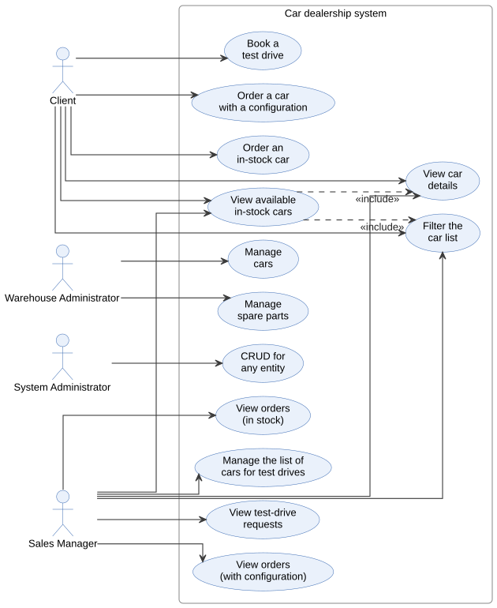

</details>

<details>
<summary><b>In-stock car order: states</b></summary>
<br/>

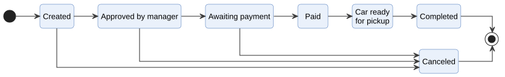

</details>

<details>
<summary><b>Configured car order: states</b></summary>
<br/>

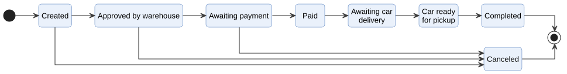

</details>


#### Architecture

<details>
<summary><b>Services, databases, Kafka topics and Keycloak</b></summary>
<br/>

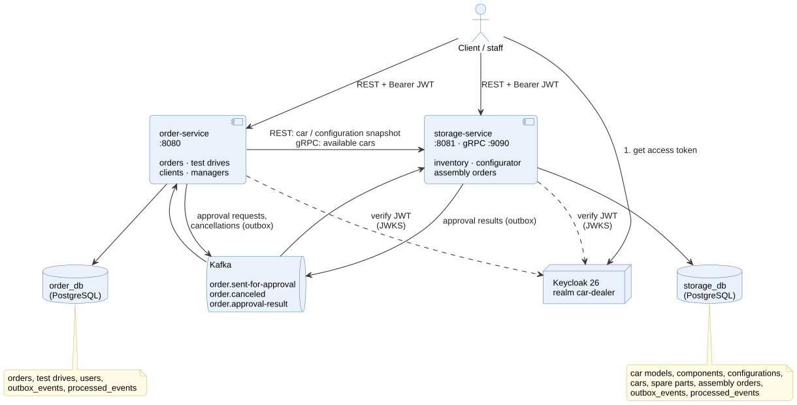

</details>

#### Domain model

<details>
<summary><b>order-service: orders, test drives, users, outbox</b></summary>
<br/>

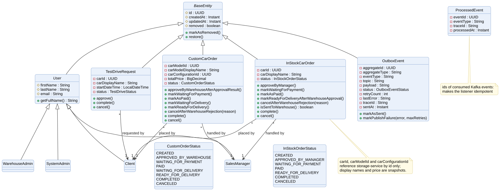

</details>

<details>
<summary><b>storage-service: inventory, configurator, assembly orders</b></summary>
<br/>

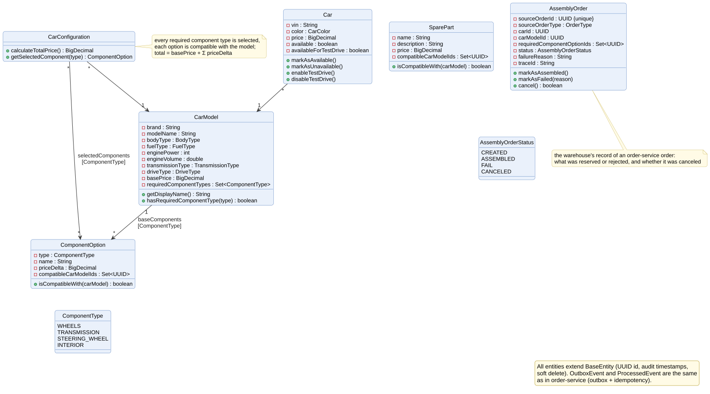

</details>

#### Interactions

<details>
<summary><b>In-stock order: payment and car reservation (saga)</b></summary>
<br/>

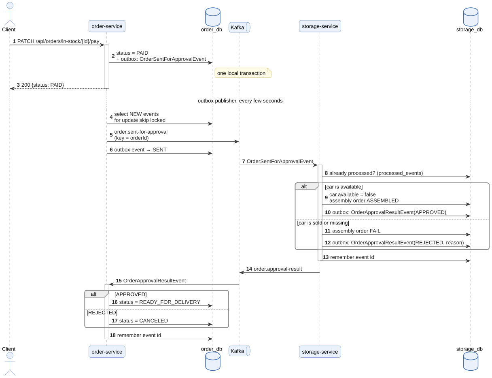

</details>

<details>
<summary><b>Configured car order: creation and warehouse check (saga)</b></summary>
<br/>

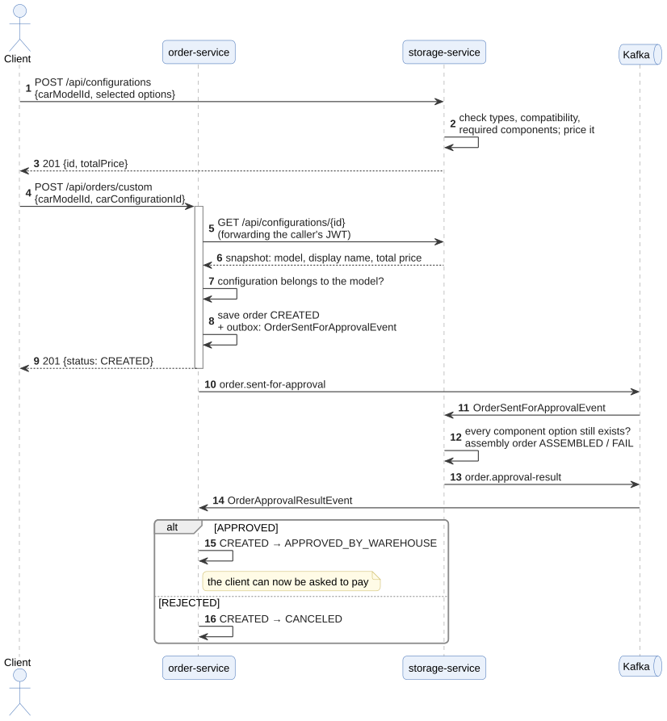

</details>

<details>
<summary><b>Order cancellation: compensation and the race with a late approval request</b></summary>
<br/>

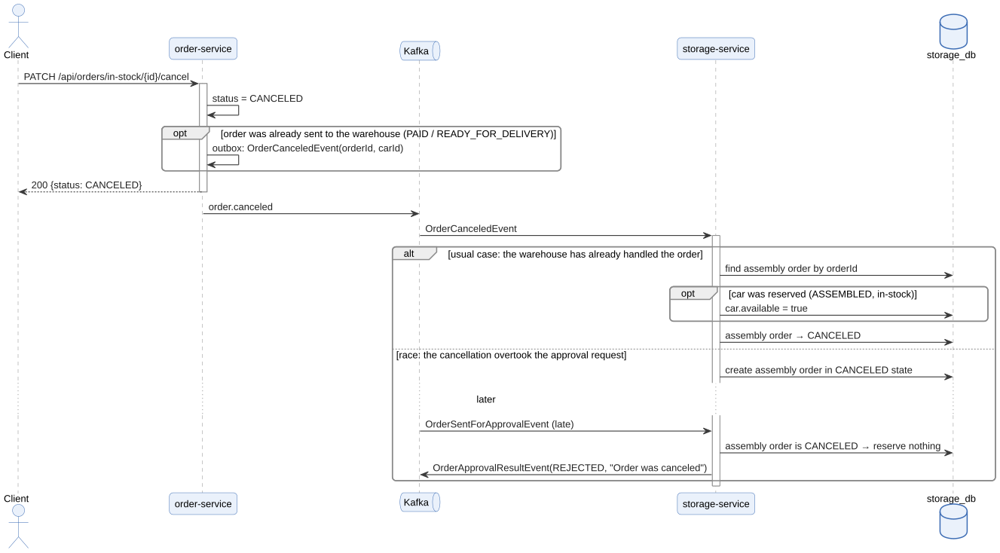

</details>

#### Lifecycles

<details>
<summary><b>Test-drive request</b></summary>
<br/>

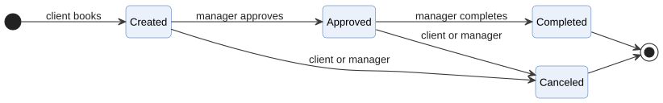

</details>

<details>
<summary><b>Assembly order (storage-service)</b></summary>
<br/>

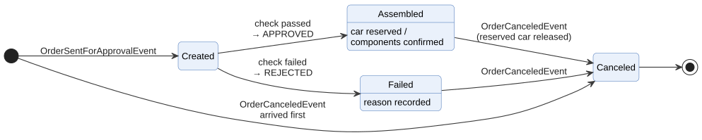

</details>

<details>
<summary><b>Outbox event</b></summary>
<br/>

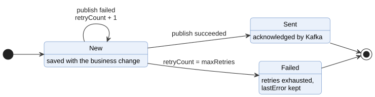

</details>

---

## Security

| Keycloak realm role | API role | Can do |
|---------------------|----------|--------|
| `CLIENT` | `USER` | Browse cars and models; configure a car; place, pay for and cancel **own** orders; book and cancel **own** test drives |
| `SALES_MANAGER` | `MANAGER` | See all orders and test drives; approve in-stock deals; request payment; move custom orders to delivery; complete orders |
| `WAREHOUSE_ADMIN` | `WAREHOUSE_ADMIN` | Manage inventory, spare parts and assembly orders |
| `ADMIN` | `ADMIN` | Everything, including deletions |

Tokens are checked against the realm's JWKS and issuer. The domain user is the token's `sub`, which matches the seeded user ids. A request without a token gets **401**. A valid token without the right role or ownership gets **403**.

---

## API

Swagger UI: `order-service` at **:8080/swagger-ui.html**, `storage-service` at **:18081/swagger-ui.html**.

| Service | Area | Endpoints |
|---------|------|-----------|
| order | **In-stock orders** `/api/orders/in-stock` | `POST /` · `GET /` (`?status=`) · `GET /{id}` · `PATCH /{id}/approve-by-manager` · `/waiting-for-payment` · `/pay` · `/complete` · `/cancel` |
| order | **Custom orders** `/api/orders/custom` | `POST /` · `GET /` (`?status=`) · `GET /{id}` · `PATCH /{id}/waiting-for-payment` · `/pay` · `/waiting-for-delivery` · `/ready-for-delivery` · `/complete` · `/cancel` |
| order | **Test drives** `/api/test-drives` | `POST /` · `GET /` · `GET /{id}` · `PATCH /{id}/approve` · `/complete` · `/cancel` · `DELETE /{id}` |
| order | **Available cars (via gRPC)** `/api/v1/cars` | `GET /` · `GET /{id}` |
| storage | **Cars** `/api/cars` | `GET /` · `GET /{id}` · `GET /available` · `GET /test-drive` · `POST /filter` · `POST` / `PUT /{id}` / `DELETE /{id}` |
| storage | **Inventory** `/api/inventory` | CRUD for `car-models`, `component-options`, `cars`, `spare-parts` · `POST /car-models/filter` |
| storage | **Configurator** `/api/configurations` | `POST /` builds and prices a configuration · `GET /{id}` |
| storage | **Assembly orders** `/api/assembly-orders` | warehouse view of what the saga reserved or rejected |
| both | **Health** | `GET /actuator/health/readiness` · `/liveness` |

gRPC (`storage-service:9090`, host port 19090):

```proto
service CarInventoryService {
  rpc GetAvailableCars(GetAvailableCarsRequest) returns (GetAvailableCarsResponse);
  rpc GetAvailableCarById(GetAvailableCarByIdRequest) returns (AvailableCarResponse);
}
```

---

## Quick Start

### Prerequisites

- Docker with Compose v2
- JDK 21, only to run the services or tests outside Docker. The Gradle wrapper is included.

### Run the published images (about a minute, nothing to build)

Every release publishes both services to GitHub Container Registry as multi-arch images (amd64 and arm64):

```bash
git clone https://github.com/thbldprncee/car-dealer-backend.git && cd car-dealer-backend
docker compose pull
docker compose up -d
```

A specific release instead of `latest`:

```bash
CAR_DEALER_VERSION=1.0.0 docker compose pull
CAR_DEALER_VERSION=1.0.0 docker compose up -d
```

| Image | |
|-------|---|
| `ghcr.io/thbldprncee/car-dealer-order-service` | orders, test drives, gRPC client |
| `ghcr.io/thbldprncee/car-dealer-storage-service` | inventory, configurator, gRPC server |

### Build from source

```bash
docker compose up -d --build
```

| Component | Host address |
|-----------|--------------|
| order-service | http://localhost:8080 (`ORDER_SERVICE_PORT=18080 docker compose up -d` if 8080 is taken) |
| storage-service | http://localhost:18081 · gRPC `localhost:19090` |
| Keycloak | http://localhost:18180 · admin console `admin` / `admin` |
| Kafka | `localhost:19092` |
| PostgreSQL | order_db `localhost:15433` · storage_db `localhost:15434` (`postgres` / `postgres`) |

### Infrastructure in Docker, services from the IDE

```bash
docker compose up -d order-db storage-db kafka keycloak
./gradlew :storage-service:bootRun     # then, in another terminal:
./gradlew :order-service:bootRun
```

### Demo users

| Username / password | Realm role | Domain user |
|---------------------|------------|-------------|
| `user` / `user` | CLIENT | Ivan Petrov |
| `manager` / `manager` | SALES_MANAGER | Anna Smirnova |
| `warehouse` / `warehouse` | WAREHOUSE_ADMIN | Oleg Sokolov |
| `admin` / `admin` | all roles | Maria Ivanova |

### Try the API: a clickable scenario

[`http/car-dealer.http`](http/car-dealer.http) walks through the whole system in 21 requests, and every response is checked:

1. log in as the client and the manager through Keycloak; requests without a token get 401;
2. list available cars (order-service → gRPC → storage-service) and filter the showroom;
3. **in-stock saga:** order → manager approval → payment → the warehouse reserves the car → cancellation → the car is back on sale;
4. **configured car:** build a configuration, see an incompatible one rejected, order it, the warehouse confirms the components;
5. book and approve a test drive; a client sees only their own orders.

**In IntelliJ IDEA:** open the file, choose the `local` environment (`local-alt-port` if order-service runs on 18080) and press *Run All Requests in File*. Tokens and ids are passed between requests automatically.

**Without an IDE**, the same file runs as a smoke test:

```bash
docker run --rm -v "$PWD/http":/workdir jetbrains/intellij-http-client \
  -D -v http-client.env.json -e local car-dealer.http
```

<details>
<summary>The same saga with curl</summary>

```bash
token() { curl -s localhost:18180/realms/car-dealer/protocol/openid-connect/token \
  -d client_id=car-dealer-backend -d grant_type=password -d username=$1 -d password=$1 | jq -r .access_token; }
USER=$(token user); MANAGER=$(token manager)
CAR=cccccccc-cccc-cccc-cccc-ccccccccccc2

ORDER=$(curl -s -X POST localhost:8080/api/orders/in-stock -H "Authorization: Bearer $USER" \
  -H 'Content-Type: application/json' -d "{\"carId\":\"$CAR\"}" | jq -r .id)
curl -s -X PATCH localhost:8080/api/orders/in-stock/$ORDER/approve-by-manager  -H "Authorization: Bearer $MANAGER" > /dev/null
curl -s -X PATCH localhost:8080/api/orders/in-stock/$ORDER/waiting-for-payment -H "Authorization: Bearer $MANAGER" > /dev/null
curl -s -X PATCH localhost:8080/api/orders/in-stock/$ORDER/pay                 -H "Authorization: Bearer $USER" | jq .status   # PAID

sleep 5   # outbox → Kafka → warehouse reserves the car → outbox → Kafka → order-service
curl -s localhost:8080/api/orders/in-stock/$ORDER -H "Authorization: Bearer $USER" | jq .status          # READY_FOR_DELIVERY
curl -s localhost:18081/api/cars/$CAR -H "Authorization: Bearer $USER" | jq .available                   # false

curl -s -X PATCH localhost:8080/api/orders/in-stock/$ORDER/cancel -H "Authorization: Bearer $USER" > /dev/null
sleep 5
curl -s localhost:18081/api/cars/$CAR -H "Authorization: Bearer $USER" | jq .available                   # true again
```

</details>

---

## Testing

```bash
./gradlew test               # unit tests, no Docker needed
./gradlew integrationTest    # each service with PostgreSQL and Kafka in Testcontainers
./gradlew build              # everything
```

| Suite | What it proves |
|-------|----------------|
| `WarehouseSagaIntegrationTest` (storage) | Through a real broker: a car is reserved on approval and released on cancellation; a cancellation that overtakes the approval request makes the warehouse reject it; a redelivered request creates exactly one assembly order |
| `OrderSagaIntegrationTest` (order) | Warehouse approval and rejection move a paid order; redelivered results are harmless; outbox events reach Kafka with the order id as the key and are marked `SENT` |
| `OrderSagaTest` | Which saga event each order step writes to the outbox: custom orders at creation, in-stock orders at payment, cancellations only when compensation is needed |
| `OrderCancellationCompensationTest` | Release only what was reserved; ignore redeliveries; reject late approval requests |
| `WarehouseApprovalIdempotencyTest`, `OrderApprovalResultListenerCustomTest` | Repeated or out-of-order warehouse results never move an order backwards |
| `CarInventoryGrpcServiceTest`, `AvailableCarControllerTest` | gRPC responses, `NOT_FOUND` / `INVALID_ARGUMENT`, deadline and unavailability mapping to HTTP |
| Security tests | Role requirements on every sensitive endpoint; warehouse transitions are not exposed over REST |

---

## Project Structure

```
car-dealer-backend/
├── common-events/                 # saga event records shared by both services
├── common-grpc/src/main/proto/    # car_inventory.proto → generated stubs
├── order-service/
│   └── src/main/java/io/github/thbldprncee/cardealer/order/
│       ├── client/                # REST client to storage (snapshots), gRPC client (inventory)
│       ├── config/                # security, trace id filter, Kafka error handling, properties
│       ├── domain/                # Order entities with state transitions, outbox, processed events
│       ├── service/               # OrderService, TestDriveService, outbox publisher, approval listener
│       └── presentation/          # REST controllers + error handler
├── storage-service/
│   └── src/main/java/io/github/thbldprncee/cardealer/storage/
│       ├── grpc/                  # CarInventoryGrpcService
│       ├── domain/                # cars, models, components, configurations, assembly orders
│       ├── service/               # inventory, configurator, approval + cancellation listeners, outbox
│       └── repository/            # Spring Data JPA + Criteria specifications
├── docs/uml/                      # PlantUML sources + rendered SVG diagrams
├── http/                          # car-dealer.http scenario + environments (IntelliJ HTTP Client)
├── docker/keycloak/               # realm export imported on start
├── docker-compose.yml
└── .github/workflows/
    ├── ci.yml                     # build + tests, both images, HTTP scenario against the full stack
    └── release.yml                # on a v*.*.* tag: test, publish images to GHCR, GitHub release
```

---

## Background

The project grew over five stages: a layered monolith with a domain model and Liquibase migrations; integration tests on Testcontainers; Keycloak security; a split into two services coordinated through Kafka with a transactional outbox; and finally a gRPC inventory API between them.
